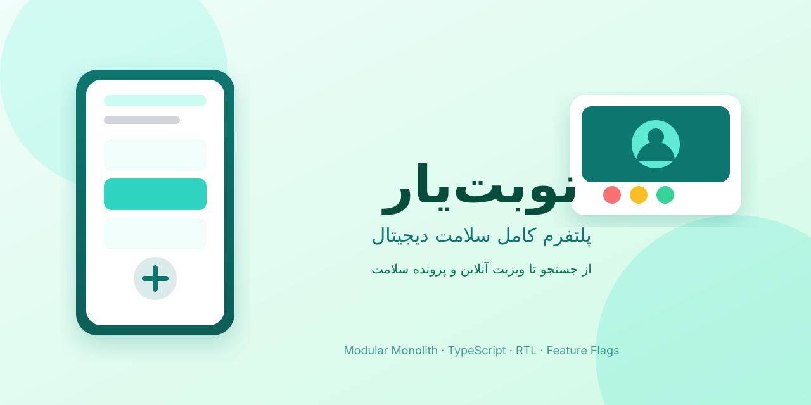
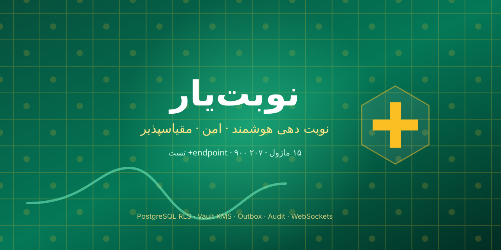

<div align="center">

# نوبت‌یار · NobatYar

**رزرو هوشمند نوبت پزشکی — امن، سریع و کاملاً فارسی / Smart medical booking — secure, fast and RTL-native**

[](https://github.com/YOUR_USERNAME/nobatyar/actions/workflows/ci.yml)
[](apps/api/openapi/openapi.json)
[](apps/api/src)
[](apps/web/src)
[](apps/e2e/tests)
[](LICENSE)
[](.nvmrc)
[](package.json)

</div>

---

## 🎬 گالری کاور / Cover gallery

| کاور تیره (Social Preview پیشفرض) | کاور ایزومتریک | کاور الگوی ایرانی |
|---|---|---|
|  |  |  |

> نسخههای PNG آمادهٔ آپلود در GitHub Social Preview در پوشهٔ `docs/assets/github/` قرار دارند. / Ready-to-upload PNG versions live in `docs/assets/github/`.

---

## 🧠 معرفی پروژه / Project introduction

**فارسی:** نوبت‌یار یک پلتفرم جامع سلامت دیجیتال به زبان فارسی و با راستچین کامل (RTL) است که کل مسیر «جستجوی پزشک → رزرو نوبت → پرداخت امن → ویزیت آنلاین یا حضوری → پرونده سلامت» را پوشش میدهد. معماری پروژه یک **Modular Monolith** مبتنی بر NestJS و Prisma است که تمام نوشتنها را از یک لایهٔ واحد با **Row Level Security** PostgreSQL عبور میدهد تا امنیت و ممیزی از همان هسته تضمین شود. این پروژه تنها یک نمونهٔ نمایشی نیست: ۱۵ ماژول کامل، ۲۰۷ عملیات مستند OpenAPI، ۹۰۰+ تست خودکار و تجهیزات کامل عملیات (SLO، Chaos، Canary، KMS، Outbox) دارد.

**English:** NobatYar is a comprehensive Persian, fully RTL digital-health platform covering the entire journey from doctor discovery and smart booking to secure payment, online/in-person visits, and a patient-centered health record. It is built as a **Modular Monolith** on NestJS and Prisma, where every write goes through a single layer enforcing PostgreSQL **Row Level Security**, guaranteeing auditability and data protection by design. This is not a demo: it ships 15 complete modules, 207 documented OpenAPI operations, 900+ automated tests, and production-grade operations tooling.

### 📊 آمار سریع / Quick numbers

| فارسی | English | مقدار |
|---|---|---|
| ماژولهای کامل | Complete modules | **15** |
| عملیات OpenAPI | OpenAPI operations | **207** |
| تست API | API tests | **729** |
| تست وب | Web tests | **190** |
| تست E2E | E2E tests | **15/15** |
| migration دیتابیس | DB migrations | **16** |
| پوشش مستندات کنترلر | Controller doc coverage | **100%** |

---

## 🛠 تکنولوژیها / Frameworks, libraries & technologies

| لایه / Layer | فارسی | English |
|---|---|---|
| Frontend | Next.js 14، React، TypeScript، RTL، Tailwind-ish utilities، Zod | Next.js 14, React, TypeScript, RTL, design tokens |
| Backend | NestJS 10، TypeScript، Zod pipes، Guards، Interceptors | NestJS 10, TypeScript, Zod pipes, Guards |
| Database | PostgreSQL 16 + Prisma 5 + RLS + migrations | PostgreSQL 16, Prisma 5, RLS, versioned migrations |
| Cache / Realtime | Redis، Socket.IO gateway، SSE | Redis, Socket.IO, SSE |
| Security | AES-256-GCM + AAD، Vault Transit KMS، MFA/Passkey، consent ledger | AES-256-GCM + AAD, Vault KMS, MFA/WebAuthn, consent ledger |
| Files | MinIO/S3 presigned URLs، magic-bytes، quarantine، ClamAV | MinIO/S3 presigned URLs, magic bytes, quarantine, ClamAV |
| Video | LiveKit short-lived scoped tokens | LiveKit scoped short-lived tokens |
| Ops | SLO burn-rate، chaos gates، canary (Argo/Prometheus)، Sentry/OpenTelemetry | SLO burn rate, chaos gates, Argo canary, observability |
| Monorepo | pnpm 9 + Turborepo + TypeScript strict | pnpm 9 + Turborepo + strict TypeScript |
| Quality | Vitest، Playwright، property tests، mutation، visual regression، a11y، SBOM | Vitest, Playwright, property/mutation/visual/a11y tooling |
| Infra | Docker Compose، GitHub Actions، Dependabot، Trivy، Gitleaks | Docker Compose, GitHub Actions, Dependabot, Trivy, Gitleaks |

---

## ✨ امکانات و ویژگیها / Features & capabilities

> فارسی: هر ماژول پشت Feature Flag اختصاصی و پیشفرض خاموش است؛ مقدار دقیق `true` تنها حالت فعالسازی است (fail-closed).
> English: Every module sits behind its own feature flag, off by default; only the exact string `"true"` enables it (fail-closed).

| ماژول | فارسی | English |
|---|---|---|
| **M1** | MFA/Passkey، کدهای بازیابی، محافظت `mfa_required` | MFA/passkeys, recovery codes, `mfa_required` handling |
| **M2** | مصورسازی ماشین وضعیت نوبت و شبیهسازیpolicy | State-machine visualizer + safe policy simulation |
| **M3** | رزرو تکرارشونده RRULE، مادیالسازی، لغو سری، ICS | RRULE recurrence, materialization, series cancel, ICS |
| **M4** | استرداد خودکار با تأیید دوگانه و worker امن | Automated refunds with dual approval and guarded worker |
| **M5** | ارکستراتور اعلان، quiet hours، قالبها، DLQ و ارتقای تلفنی | Notification orchestration, quiet hours, templates, DLQ, phone escalation |
| **M6** | امنیت فایل با magic bytes، قرنطینه، اسکن ClamAV، دانلود فقط برای APPROVED | File security: magic bytes, quarantine, ClamAV, APPROVED-only downloads |
| **M7** | دستیار چت: حذف حساسیتها، خلاصه استخراجی با رضایت، پاسخ سریع | Chat assist: redaction, extractive consented summaries, quick replies |
| **M8** | اتاق ویدئو با اتاق انتظار، ضبط فقط با رضایت دوطرفه، retention | Smart video rooms, waiting room, dual recording consent, retention |
| **M9** | تایم\lاین سلامت، بازسازی داروها، خروجی رمزشده با کلید بیمار | Health timeline, medication reconciliation, patient-key encrypted export |
| **M10** | حاکمیت triage: ruleset توضیحپذیر، قاعده اورژانسی اجباری، پیام ۱۱۵ | Triage governance: explainable rulesets, mandatory emergency rule, 115 notice |
| **M11** | محاسبه burn rate، هشدار/rollback، chaos ایمن، canary | Burn-rate alerts/rollback, safe chaos drills, Argo canary |
| **M12** | property test، mutation، visual regression، a11y، SBOM، رفع flaky | Property/mutation/visual/a11y tooling, SBOM, flaky quarantine |
| **M13** | تحلیل بدون PHI: فونل، cohort/NPS، A/B با هش امن | PHI-free funnel, cohorts, NPS, A/B with safe hashing |
| **M14** | کلینیکها با jستجوی haversine، فضای کاری پزشک، طرح سازمانی | Clinic discovery with haversine, doctor workspace, org plans |
| **M15** | ترجیحات ظاهر و دسترسپذیری (تم، فونت، کنتراست، حرکت) | Accessibility/UI preferences (theme, scale, contrast, motion) |

### 🔐 امنیت و انطباق / Security & compliance

- تمام نوشتنها با `prisma.withContext` و RLS — *all writes through RLS context*
- رمزنگاری فیلدها با AES-256-GCM و AAD — *field-level encryption with AAD*
- KMS fail-closed در production — *fail-closed KMS in production*
- Audit، Outbox، Idempotency، Consent receipts — *audit, outbox, idempotency, consent ledger*
- عدم ورود PHI به لاگ/telemetry/analytics — *no PHI in logs or analytics*

---

## 🚀 شروع سریع / Quick start

```bash
corepack enable
pnpm install
cp .env.example .env
pnpm --filter @nobatyar/api gen:keys
pnpm infra:up
pnpm --filter @nobatyar/api db:init
pnpm --filter @nobatyar/shared build
pnpm --filter @nobatyar/api dev     # http://localhost:3000
pnpm --filter @nobatyar/web dev     # http://localhost:3001
```

**فارسی:** ورود دمو تنها در محیط غیر production و با `DEMO_AUTOLOGIN=true` فعال است. هیچ حساب نمونهای در production ساخته نمیشود.

**English:** Demo login is enabled only in non-production with `DEMO_AUTOLOGIN=true`; no demo account is ever created in production.

---

## ✅ کیفیت و تست / Quality & tests

```bash
pnpm quality:all        # typecheck + unit + OpenAPI check
pnpm quality:mutation   # killed 3/3 mutants
pnpm quality:visual     # needs E2E_BASE_URL + E2E_CHANNEL
pnpm quality:a11y       # zero critical violations
pnpm quality:sbom       # docs/sbom.json
pnpm canary:dry         # safe dry-run
pnpm e2e                # 15/15
```

مستندات more: `docs/FINAL-DELIVERY-REPORT.md` · `docs/quality-tooling.md` · `docs/runbooks/`.

---

## 📚 مستندات / Documentation

- [گزارش نهایی / Final delivery report](docs/FINAL-DELIVERY-REPORT.md)
- [طرح M1–M4](docs/plan-M1-M4-identity-booking-payment.md) · [M5–M8](docs/plan-M5-M8-comms-files-chat-video.md) · [M9–M12](docs/plan-M9-M12-health-ops-quality.md) · [M13–M15](docs/plan-M13-M15-growth-design.md)
- [امنیت فایل / File security](docs/m6-file-security.md) · [چرخش کلید / Key rotation](docs/runbooks/key-rotation.md) · [Canary](docs/runbooks/canary.md)
- [راهنمای انتشار گیت هاب / GitHub publishing](docs/GITHUB-PUBLISH.md) · [حقوقی / Legal](LEGAL.md)

---

## ⚖️ مجوز و کپی / License & copying

**فارسی:** این مخزن پابلیک است ولی **همه حقوق محفوظ** است. مشاهده و ارزیابی مجاز است؛ کپی، فورک، تغییر، استقرار و بازتوزیع بدون اجازهٔ کتبی ممنوع است. جزئیات: `LICENSE` و `LEGAL.md`.

**English:** This repository is public but **All Rights Reserved**. Viewing and evaluation are allowed; copying, forking, modifying, deploying, or redistributing without written permission is prohibited. See `LICENSE` and `LEGAL.md`.

---

## 💚 متن تبلیغاتی / Closing pitch

**فارسی:** نوبت‌یار فقط یک سیستم نوبتدهی نیست؛ یک اکوسیستم کامل سلامت دیجیتال است که با ۱۵ ماژول، معماری امن RLS، رمزنگاری سطح فیلد، پروندهٔ بیمارمحور، ویزیت آنلاین و عملیات خودمختار، تجربهای ساخته است که هم برای بیمار ساده است و هم برای تیم مهندسی قابل اعتماد. اگر بهدنبال نمونهای جدی از یک پروژهٔ RTL فارسی با استاندارد production هستید، این همان است.

**English:** NobatYar is not just a booking system — it is a complete digital-health ecosystem with 15 modules, RLS-backed security, field-level encryption, a patient-centered record, online visits, and autonomous operations. It is simple for patients and trustworthy for engineers. If you are looking for a serious, production-grade Persian RTL reference, this is it.

---

<div align="center">

ساخته شده با 💚 توسط Mohammad Atash · © 2026 · All rights reserved.

</div>
