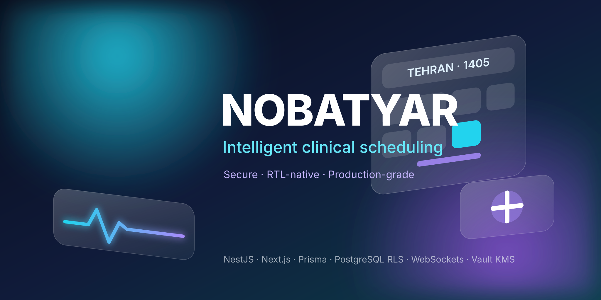
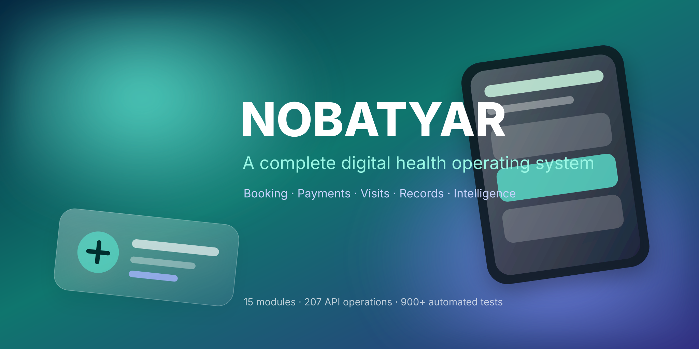
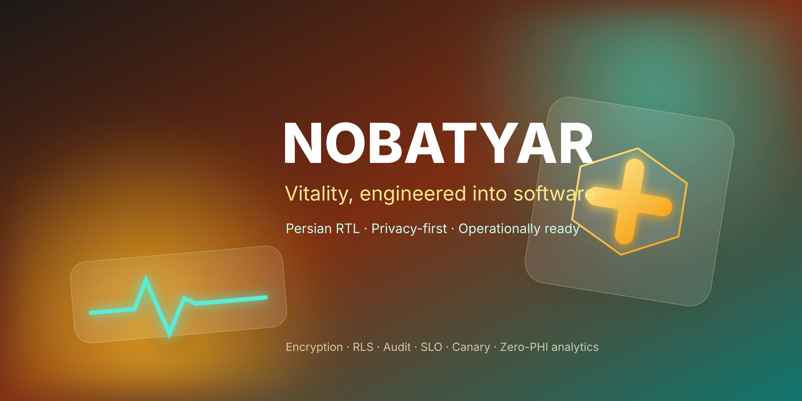
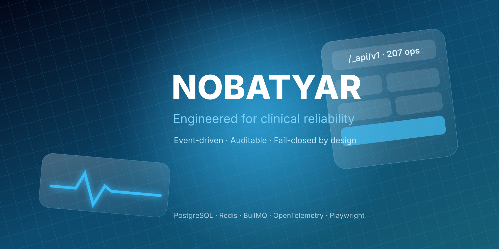
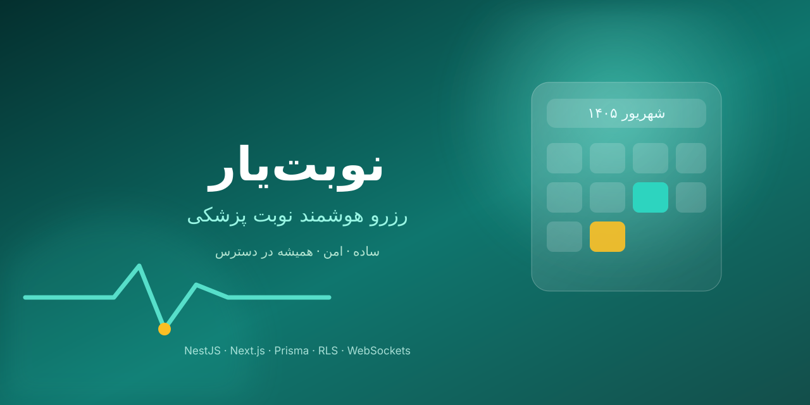
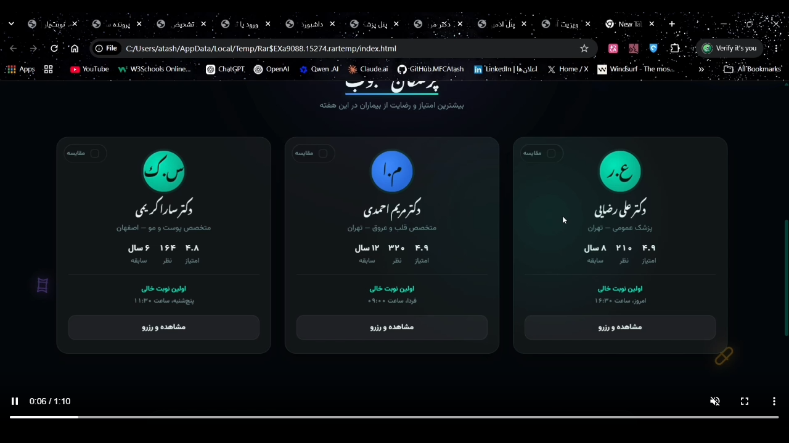

<div align="center">

# NOBATYAR

### The production-grade Persian digital health platform for intelligent clinical scheduling, secure consultations, and patient-centered records.

[](https://github.com/YOUR_USERNAME/nobatyar/actions/workflows/ci.yml)
[](apps/api/openapi/openapi.json)
[](apps/api/src)
[](apps/web/src)
[](apps/e2e/tests)
[](scripts/quality-mutation.mjs)
[](LICENSE)
[](.nvmrc)
[](package.json)

</div>

---

## Visual identity

### Signature covers — 2560 × 1280, volumetric light, layered 3D glass

| Neon glass | Aurora depth |
|---|---|
|  |  |

| Amber vitality | Quantum mesh |
|---|---|
|  |  |

### Original cover set — 1280 × 640

| Dark teal | Isometric | Persian geometry |
|---|---|---|
|  |  |  |

High-resolution PNG files for GitHub Social Preview and all editable SVG sources are available in `docs/assets/github/`.

---

## Product demo video

[](docs/assets/video/video_2026-11-22_19-39-31.mp4)

A 1:10 walkthrough of the doctor-discovery and booking experience, recorded from the running application. Click the poster to open the MP4 in GitHub's native video player. The source file is stored at `docs/assets/video/video_2026-11-22_19-39-31.mp4` (20 MB, well below GitHub's 100 MB file limit; Git LFS is not required).

---

## 1. Executive summary

NobatYar is a comprehensive, production-oriented digital health platform engineered around the entire clinical journey: doctor discovery, intelligent appointment scheduling, deterministic payment handling, online and in-person consultations, and a patient-centered health record. It is a fully right-to-left (RTL) Persian product built as a **Modular Monolith**, where a single NestJS/Prisma write layer enforces PostgreSQL Row Level Security on every transaction. This design decision is deliberate: authorization, ownership, consent, and auditability are guaranteed by the data layer rather than by scattered application checks.

The project is not a prototype. It comprises **15 feature modules**, **207 documented OpenAPI operations**, **729 API tests**, **190 frontend tests**, **15 end-to-end browser tests**, **16 versioned database migrations**, and a complete operations toolchain covering SLO burn-rate analysis, safe chaos drills, Argo-based canary rollouts, Vault Transit key management, and automated SBOM generation. Every module is gated behind a dedicated feature flag that is **off by default** and enabled only by the exact value `"true"` — a fail-closed posture applied consistently across backend and frontend.

NobatYar demonstrates how a regulated domain such as healthcare can be implemented with strong engineering discipline: explicit state machines, transactional side effects through an outbox, idempotent financial operations, field-level encryption with AAD, consent receipts, privacy-safe analytics, and a test pyramid that includes property-based, mutation, visual-regression, accessibility, and contract testing.

---

## 2. Engineering philosophy and system architecture

### 2.1 Architectural decisions

| Decision | Rationale |
|---|---|
| **Modular Monolith** over microservices | Preserves transactional integrity and simple deployment while keeping domain boundaries explicit through NestJS modules. |
| **Single write path** via `prisma.withContext` | Every write sets `app.user_id`, `app.role`, and break-glass state inside a transaction so RLS policies are authoritative. |
| **Database as the final authority** | PostgreSQL RLS, constraints, and unique indexes prevent double-booking even under concurrent application requests. |
| **Outbox + workers** | Side effects (notifications, refunds, recurring materialization) are durable, retryable, and auditable. |
| **State machines in shared code** | Appointment, payment, and refund transitions are defined once in `packages/shared` and reused by API and UI. |
| **Contract-first API** | The OpenAPI registry is the source of truth; tests assert 100% controller coverage and zero stale documentation. |
| **Fail-closed configuration** | Production requires real KMS/Vault, real gateway credentials, and strict storage settings; missing configuration aborts startup. |
| **Feature flags as release control** | All 15 modules ship dark; rollout is a configuration decision, not a deployment decision. |

### 2.2 Request and data flow

1. **Identity** — OTP or passkey login issues short-lived JWT access tokens and rotating refresh cookies; MFA challenges are enforced globally.
2. **Authorization** — Guards evaluate role, resource ownership, consent, and MFA before a controller reaches a service.
3. **Transaction context** — Services open a Prisma transaction with an explicit identity context; RLS policies constrain every row touched.
4. **Domain logic** — Pure policy modules (`recurring-policy`, `reschedule-policy`, `triage ruleset`, `room-policy`, `funnel`, `timeline`) keep decisions deterministic and unit-testable.
5. **Side effects** — Outbox records are written inside the same transaction and drained by idempotent workers.
6. **Observability** — Structured JSON logs, OpenTelemetry tracing, Sentry scrubbing, and metrics exclude PHI by construction.

### 2.3 Domain boundaries

`Identity & Access` · `Doctor Verification` · `Availability` · `Appointment` · `Payment & Refund` · `Notification` · `File Service` · `Conversation` · `Video` · `Health Record` · `Triage & Second Opinion` · `Admin & Audit` · `Analytics` · `Growth` · `Design System`.

---

## 3. Complete technology stack

### 3.1 Languages and core runtime

| Category | Technology | Usage |
|---|---|---|
| Language | TypeScript (strict) | Entire monorepo, API, web, shared packages, scripts |
| Runtime | Node.js ≥ 20.11 | API runtime, build tooling, quality scripts |
| Package manager | pnpm 9.12.0 with Corepack | Deterministic workspace installs |
| Monorepo | Turborepo 2 | Task orchestration, caching, parallel pipelines |

### 3.2 Frontend

| Technology | Purpose |
|---|---|
| Next.js 14 (App Router) | Server and client rendering, routing, static generation |
| React 18 | UI component model |
| RTL layout + design tokens | Persian-first typography, themes, density and font scales |
| Zod | Client-side schema validation shared with the API contract |
| Socket.IO client + custom SSE client | Real-time chat and notification streaming |
| WebAuthn browser library | Passkey registration and authentication |
| Service Worker / PWA | Offline shell, installability, cache discipline |
| Vitest + Playwright | Unit, component, visual and end-to-end testing |

### 3.3 Backend

| Technology | Purpose |
|---|---|
| NestJS 10 | Modules, DI, guards, interceptors, WebSockets, scheduled jobs |
| Prisma 5 | Typed data access, migrations, transaction contexts |
| PostgreSQL 16 | Relational store, RLS, constraints, JSONB, gen_random_uuid |
| Redis + BullMQ | Caches, rate limiting, pub/sub, repeatable jobs |
| Socket.IO gateway | Authenticated real-time conversations |
| SSE | Notification stream with Last-Event-ID resumption |
| Zod pipes | Runtime validation at controller boundaries |
| jose | JWT issuance, verification, LiveKit token signing |
| Class-based policy modules | Pure deterministic domain rules |

### 3.4 Security and cryptography

| Technology | Purpose |
|---|---|
| AES-256-GCM with AAD | Field-level encryption bound to table, row, and column |
| Vault Transit / KMS adapter | Production key management with fail-closed validation |
| Blind indexes (HMAC) | Searchable phone numbers without plaintext storage |
| OTP + JWT + MFA + WebAuthn | Layered authentication |
| PostgreSQL RLS + break-glass audit | Ownership enforcement with audited exceptions |
| Consent receipts and ledger | Explicit, versioned, attributable consent records |
| ClamAV + magic-byte analysis | Malware scanning and content allow-listing |
| Gitleaks, Trivy, Semgrep | Secret, dependency and static analysis gates |

### 3.5 Infrastructure and operations

| Technology | Purpose |
|---|---|
| Docker Compose | Local Postgres, Redis, MinIO, LiveKit, monitoring stacks |
| GitHub Actions | CI, scheduled security scans, release and canary workflows |
| Sentry + OpenTelemetry | Error tracking and tracing with PHI scrubbing |
| Prometheus | Burn-rate signal source for canary decisions |
| Argo Rollouts | Weight-based canary promotion and abort |
| Playwright | Browser E2E, accessibility audits, visual baselines |
| CycloneDX-style SBOM | Dependency inventory generated from the lockfile |

---

## 4. Feature catalog

### M1 — MFA and passkey-first identity
TOTP enrollment, recovery codes, MFA challenge handling in the API client, WebAuthn credentials, session revocation, and an admin-specific MFA E2E test that drives the real UI.

### M2 — Policy visualization
Mermaid rendering of the appointment state machine, invariant display, and a server-side policy simulator that evaluates transitions without touching the database.

### M3 — Smart booking
RRULE-based recurring series, incremental materialization through the scheduler, series-wide cancellation, slot conflict detection, and RFC 5545 ICS calendar export.

### M4 — Automated refunds
A guarded worker that only runs behind both a module flag and worker enablement, routes every payout through `RefundService.execute`, enforces maker/checker approval, treats ambiguous gateway outcomes as `REVIEW`, and ships a sandbox refund test across success, failure, and pending modes.

### M5 — Notification orchestration
Seven event types across in-app, SMS, push, email, and call escalation channels; quiet-hour suppression with urgent override; versioned templates; dead-letter queue; retry policy; and an on-call escalation decision recorded in the audit log.

### M6 — Secure file pipeline
Content-based MIME detection using magic bytes, a strict allow-list, a quarantine state machine (`PENDING → SCANNING → APPROVED | REJECTED`), ClamAV integration, PHI-safe logging, and download URLs issued only for approved objects. A dedicated upload page implements the presigned `PUT` followed by server-side finalization.

### M7 — Chat assistant
Extraction-based summaries (never generative diagnosis), redaction of phone numbers, emails and national identifiers, AES-encrypted summary storage with AAD, patient consent enforcement, and doctor-scoped quick replies capped at ten entries.

### M8 — Smart video rooms
Waiting room enabled by default, screen sharing disabled by default, recording permitted only with both patient and doctor receipts hashed to the specific appointment, retention deadline computation, and short-lived LiveKit tokens scoped to one room and identity.

### M9 — Patient-centered record
Clinical timeline with explicit units and Persian numeral parsing, two-point trend derivation, medication reconciliation with non-diagnostic interaction warnings, consent ledger, and encrypted export using scrypt plus AES-256-GCM where the server never retains the passphrase.

### M10 — Triage governance
Rulesets reject missing emergency rules and forbidden diagnostic claims, are stored encrypted, and always return an explanation plus the emergency 115 notice. An admin UI creates and validates versioned rulesets.

### M11 — Autonomous operations
Multi-window error-budget burn-rate calculation, `ok → ticket → page → rollback` severity policy, chaos drills restricted to non-production targets with explicit approval and change windows, synthetic checks, and a production-ready Argo/Prometheus canary gate with dry-run defaults.

### M12 — Continuous quality
Deterministic property tests, a dependency-free mutation harness, Playwright visual regression baselines, DOM accessibility auditing, SBOM generation, and a stabilized SSE test suite — all wired into `pnpm quality:all` and companion scripts.

### M13 — Privacy-safe analytics
Six-step booking funnel with unique-user counting, weekly cohort retention, NPS classification, A/B experiment registry, salted metadata hashing, and strict allow-listed metadata keys that reject PII-looking values.

### M14 — Clinic ecosystem
Haversine distance ranking with deterministic sorting, verified-clinic filtering, doctor dashboard workspace selection, organization plans, and seat-capacity checks.

### M15 — Accessibility and design
User preferences for theme, font scale, contrast, reduced motion, and locale, exposed through `GET|PUT /me/ui-preferences` and a dedicated settings page with automated critical-violation checks.

---

## 5. Technical highlights

- **Concurrent booking safety** — database constraints plus transactional validation prevent double-booking.
- **Deterministic money movement** — idempotency keys, ledger posting, reconciliation, and two-person refund approval.
- **Consent as data** — receipts are hashed, versioned, attributed, and checked before sensitive operations.
- **Privacy by construction** — analytics stores hashes, not content; logs and traces are scrubbed.
- **Ambiguity handling** — uncertain gateway or scanner outcomes escalate to review instead of being guessed.
- **Configuration as a gate** — production refuses to boot without valid KMS, gateway, and storage settings.
- **Operational readiness** — SLO burn-rate math, chaos with auto-rollback, canary decision scripts, and runbooks are part of the repository.
- **Verification depth** — unit, integration, property, mutation, contract, visual, accessibility, and E2E layers are all present and green.

---

## 6. Repository layout

```text
apps/web        Next.js 14 RTL client
apps/api        NestJS 10 API, Prisma, workers, OpenAPI
apps/e2e        Playwright E2E, visual baselines, a11y specs
packages/shared Shared state machines, schemas, flags
docs            Architecture, plans, runbooks, reports, covers
infra           Docker Compose, Vault, monitoring
scripts         DB, canary, quality and release tooling
```

---

## 7. Getting started

```bash
corepack enable
pnpm install
cp .env.example .env
pnpm --filter @nobatyar/api gen:keys
pnpm infra:up
pnpm --filter @nobatyar/api db:init
pnpm --filter @nobatyar/shared build
pnpm --filter @nobatyar/api dev   # http://localhost:3000
pnpm --filter @nobatyar/web dev   # http://localhost:3001
```

Demo login is enabled only outside production with `DEMO_AUTOLOGIN=true`. No demo account is ever created in production.

---

## 8. Verification and quality gates

```bash
pnpm quality:all        # typecheck + unit tests + OpenAPI check
pnpm quality:mutation   # deterministic mutation harness
pnpm quality:visual     # Playwright screenshot baselines
pnpm quality:a11y       # critical accessibility violations
pnpm quality:sbom       # CycloneDX-style inventory
pnpm canary:dry         # safe canary decision preview
pnpm e2e                # 15/15 browser tests
```

Current verified state: **729 API tests**, **190 web tests**, **15/15 E2E**, **100% controller documentation coverage**, **100% mutation kill rate**, **zero critical accessibility violations**.

---

## 9. Documentation

- Final delivery report: `docs/FINAL-DELIVERY-REPORT.md`
- Quality tooling: `docs/quality-tooling.md`
- File security: `docs/m6-file-security.md`
- Key rotation: `docs/runbooks/key-rotation.md`
- Canary: `docs/runbooks/canary.md`
- GitHub publishing: `docs/GITHUB-PUBLISH.md`
- Legal notice: `LEGAL.md`

---

## 10. License and view-only notice

This repository is published on GitHub for **viewing and evaluation only**. All rights are reserved. Copying, forking, modifying, deploying, redistributing, or any commercial use without prior written permission from the copyright holder is prohibited. See `LICENSE` and `LEGAL.md`.

GitHub public visibility is a hosting setting, not a license. When strict technical prevention of copying is required, the repository can be switched to private with `Read`-only collaborators.

---

## 11. Closing statement

NobatYar is not merely an appointment booker. It is a rigorously engineered digital health ecosystem that unites fifteen production-grade modules under one secure, auditable, and operationally ready architecture. It pairs a patient-friendly RTL experience with RLS-enforced data access, field-level encryption, consent receipts, resilient money movement, privacy-safe analytics, and a full canary and SLO toolchain. Every layer was built to be explainable, testable, and fail-closed.

For teams seeking a serious reference implementation of Persian RTL healthcare software — one where security, engineering discipline, and user experience are treated as first-class requirements rather than afterthoughts — NobatYar sets the standard.

Built with precision. Secured by design. Ready for the next stage of care.
