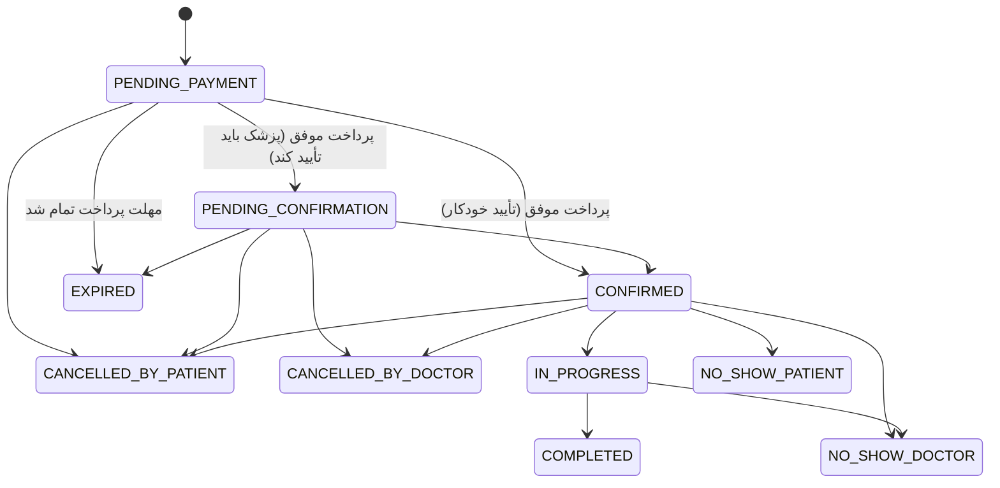

# قواعد نوبت‌دهی

## ۱. ماشین وضعیت

پیاده‌سازی: `packages/shared/src/appointment.ts` (با تست).

## ۲. قواعد زمان‌بندی
| قاعده | پیشنهاد پیش‌فرض (قابل تغییر با تأیید مالک محصول) |
|---|---|
| مدت اسلات | ۱۵/۲۰/۳۰ دقیقه به‌ازای هر پزشک |
| حداقل فاصله تا نوبت | ۳۰ دقیقه |
| بیشترین بازه‌ی رزرو آینده | ۶۰ روز |
| مهلت پرداخت (نگه‌داشتن اسلات) | ۱۰ دقیقه، سپس EXPIRED |
| مهلت تأیید پزشک | ۲۴ ساعت یا تا ۲ ساعت قبل نوبت، سپس EXPIRED + بازپرداخت |
| لغو توسط بیمار | تا ۲۴ ساعت قبل: بازپرداخت کامل؛ ۲–۲۴ ساعت: [؟ ٪]؛ کمتر از ۲ ساعت: بدون بازپرداخت |
| لغو توسط پزشک | همیشه بازپرداخت کامل + اطلاع‌رسانی فوری |
| غیبت بیمار | بدون بازپرداخت؛ ثبت در سابقه |
| غیبت پزشک | بازپرداخت کامل + نشانه‌گذاری برای ادمین |
| جابه‌جایی | = لغو + رزرو جدید تا ۲۴ ساعت قبل (یک بار رایگان) |
| سقف نوبت‌های هم‌زمان باز هر بیمار | ۳ (ضد سوءاستفاده) |

## ۳. جلوگیری از رزرو دوبل (سطح دیتابیس)
قید در فاز ۱ (SQL خام داخل مهاجرت Prisma):
```sql
ALTER TABLE appointment
  ADD CONSTRAINT no_double_booking
  EXCLUDE USING gist (
    doctor_id WITH =,
    tstzrange(starts_at, ends_at, '[)') WITH &&
  )
  WHERE (status IN ('PENDING_PAYMENT','PENDING_CONFIRMATION','CONFIRMED','IN_PROGRESS'));
```
+ تراکنش با سطح ایزوله‌سازی مناسب و خطای 409 قابل‌فهم برای کاربر.

## ۴. زمان
> **قرارداد هفته:** `weekday` = هفته‌ی ایرانی، 0=شنبه، 1=یکشنبه، … 6=جمعه. آفست تهران ثابت ‎+۰۳:۳۰ است (ایران ساعت تابستانی ندارد؛ ثابت در `scheduling/slots.ts`).
- ذخیره: UTC (`timestamptz`)؛ نمایش: `Asia/Tehran` و تقویم جلالی در UI.
- هر اسلات از روی `AVAILABILITY_RULE` (هفتگی) منهای `TIME_OFF` و نوبت‌ها تولید می‌شود.
- کار زمان‌بندی‌شده (انقضا، یادآوری ۲۴h/۱h) با BullMQ، **ایدمپوتنت**.

## ۵. مجوزها
| عمل | بیمار | پزشک | ادمین |
|---|---|---|---|
| ایجاد نوبت | ✅ (برای خود) | ❌ | ✅ (با ثبت) |
| تأیید/رد | ❌ | ✅ (نوبت‌های خودش) | ✅ |
| لغو | ✅ (خودش) | ✅ (خودش) | ✅ |
| مشاهده | فقط خودش | فقط نوبت‌های خودش | همه (ثبت در Audit) |

## ۶. مواردی که باید تأیید شود
- [ ] مقادیر جدول بند ۲، به‌ویژه درصدهای بازپرداخت
- [ ] تأیید دستی پزشک یا خودکار؟ (قابل تنظیم به‌ازای پزشک؟)
- [ ] نوبت حضوری هم پوشش داده می‌شود یا فقط آنلاین؟
