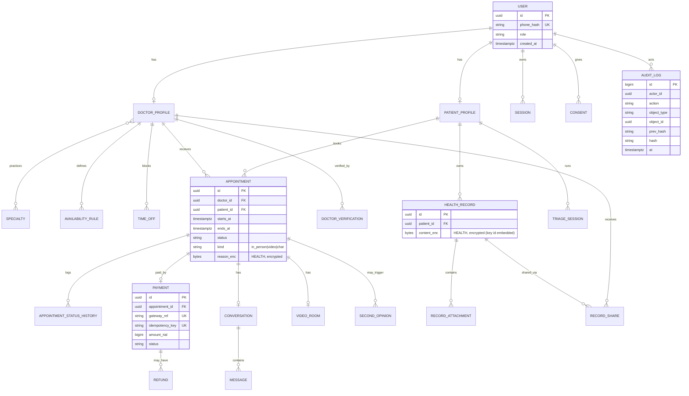

# نمودار ER (نسخه‌ی مفهومی — مبنای اسکیمای Prisma در فاز ۱)

## یادداشت‌های طراحی
- `USER` پایه + پروفایل‌های جدا (بیمار/پزشک)؛ نقش در `USER.role`.
- `RECORD_SHARE` تنها مسیر دسترسی پزشک به پرونده‌ی بیمار غیر از نوبت فعال است (رضایت‌محور).
- جدول‌های HEALTH با ستون‌های `*_enc`؛ شناسه‌ی کلید داخل بلاب است (چرخش کلید بدون ستون جدا).
- مبلغ‌ها به ریال و `bigint`؛ زمان‌ها `timestamptz` به UTC.
- `AUDIT_LOG` فقط INSERT (REVOKE UPDATE/DELETE) و زنجیره‌ی هش.
