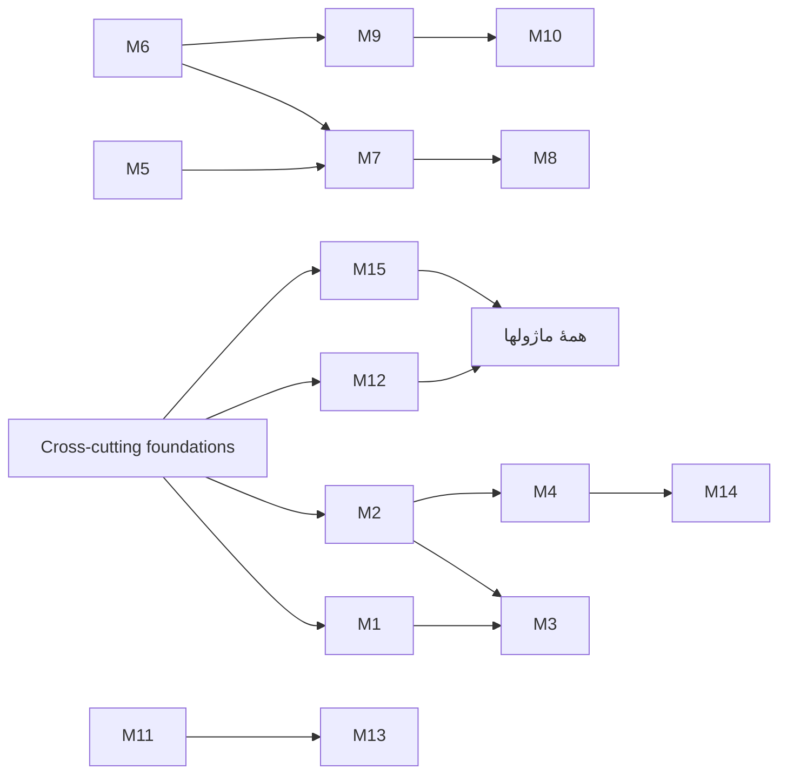

# نقشهٔ اجرایی جامع —همهٔ ۱۵ ماژول (اجرای موازی)

تاریخ: ۲۱ آذر ۱۴۰۵ · منبع: `docs/roadmap-analysis-2026-11-21.md`
انتخاب کاربر: **M1–M15** · اولویت: **موازی** · قالب خروجی: **طرح اجرایی + قرارداد API/DB + نمونه بصری + تست**

---

## ۱. اصول حاکم برهمهٔ ماژولها

1. **هیچ ماژولی مستقیماً وارد production نمیشود** — هرکدام پشت feature flag مخصوص: `FF_M1_PASSKEY_FIRST` … `FF_M15_WCAG`.
2. **Modular Monolith بماند** — ماژولها داخل `apps/api/src/<module>` و `apps/web/src/<feature>` اضافه میشوند، نه سرویسهای جداگانه.
3. **NestJS تنها مالک نوشتن DB** —همهٔ نوشتها از طریق Prisma با `prisma.withContext` و RLS.
4. **قرارداد مشترک** — انواع و state machineها در `packages/shared`؛ OpenAPI ۱۴۹/۱۴۹ حفظ شود.
5. **داده سلامت هرگز در log/analytics/traces** — telemetry فقط تجمیعی و هششده.
6. **DoD هر ماژول** = migration + contract + permission/consent + UI + error states + test + secure log + env/docs + review دوم + rollback/flag.

---

## ۱.۵ شکافهای واقعی (راستیآزمایی شده با کد — مبنای برنامهٔ زیر)

| شکاف واقعی | ماژول مسئول |
| --- | --- |
| هندلینگ `mfa_required` در frontend و صفحهٔ عمومی MFA | M1 |
| policyها پراکنده و فاقد نمودار/شبیهساز | M2 |
| رزرو periodic/تقویم/رتبهبندی اسلات | M3 |
| refund worker خودکار (فعلاً دستی Maker–Checker) | M4 |
| ترجیحات اعلان وجود ندارد (مرکز اعلان هست) | M5 |
| magic bytes، quarantine، malware scan، مسیر آپلود `verification/` | M6 |
| **تست E2E چت بلادرنگ قرمز** + rate limit چت | M7 |
| precheck سمت سرور + consent ضبط ویدئو | M8 |
| medication reconciliation و consent ledger | M9 |
| governance بالینی و escrow نظر دوم | M10 |
| feature flag اختصاصی (فقط canary/محیطی وجود دارد) + KMS واقعی | M11 |
| property/fuzz/mutation/visual/a11y/SBOM + قرنطینهٔ flaky | M12 |
| فونل/cohort/NPS/A-B | M13 |
| پروفایل Clinic و PWA/offline | M14 |
| design system مشترک و WCAG 2.2 CI | M15 |

> نکته: رودمپ اصلی «password نیمهکاره»، «Noop notifier» و «نبود FHIR/triage» را reported کرده بود، ولی کد واقعی اینها را حل کرده است — بنابراین M1 شامل password UI نمیشود (ADR-0002: OTP + Passkey).

---

## ۲. گراف وابستگیها

**زیرساخت مشترک (F)** — قبل از موج ۱:
- `packages/shared/src/flags.ts` — تایپ feature flagها
- `packages/shared/src/policy.ts` — اجرای policy بهصورت code (برای M2)
- `apps/api/src/common/audit.ts` — audit emitter با correlation ID
- `apps/api/src/common/telemetry.ts` — wrapper امن برای metricها (بدون PHI)
- `apps/web/src/components/system/ModuleGate.tsx` — گیت نمایش بر اساس flag

---

## ۳. موجهای اجرای موازی

| موج | Track A | Track B | Track C | Track D | خروجی |
| --- | --- | --- | --- | --- | --- |
| ۰ | Foundations (F) | — | — | — | flag/policy/audit/telemetry |
| ۱ | M1 هویت | M2 state machine | M3 رزرو | M4 پرداخت | باگ چت بسته شود |
| ۲ | M5 اعلان | M6 فایل | M7 چت | M8 ویدئو | connectivity کامل |
| ۳ | M9 پرونده | M10 triage | M11 عملیات | M12 کیفیت | governance + SLO |
| ۴ | M13 تحلیل | M14 اکوسیستم | M15 طراحی | — | beta readiness |

> هر Track دارای صاحب جداگانه است؛ gateها (B/D/E) قبل از موج بعدی بررسی میشوند.

---

## ۴. شاخصهای پذیرش کلی

| شاخص | هدف |
| --- | --- |
| typecheck / lint | ۰ خطا درهمهٔ ۵ پکیج |
| unit tests | ≥ ۵۴۵ + تستهایใหม่ (هدف ۶۵۰+) |
| integration | RLS و IDOR منفیهمهٔ سبز |
| E2E | مسیر رزرو→پرداخت→چت→ویدئو سبز (چت قرمز فعلی رفع شود) |
| OpenAPI | ۱۴۹/۱۴۹ یا بیشتر بدون documentation drift |
| PHI در log | ۰ مورد ( automated scan ) |
| feature flags |همهٔ ماژولها قابل خاموش کردن در < ۱ دقیقه |

---

## ۵. فهرست اسناد تفصیلی

- `docs/plan-M1-M4-identity-booking-payment.md` — هویت، state machine، رزرو هوشمند، پرداخت
- `docs/plan-M5-M8-comms-files-chat-video.md` — اعلان، فایل، چت، ویدئو
- `docs/plan-M9-M12-health-ops-quality.md` — پرونده، triage، عملیات، کیفیت
- `docs/plan-M13-M15-growth-design.md` — تحلیل، اکوسیستم، طراحی
- `docs/roadmap-options.html` — منوی بصری
- `docs/roadmap-options-prototypes.html` — نمونهٔ بصری صفحات.new
